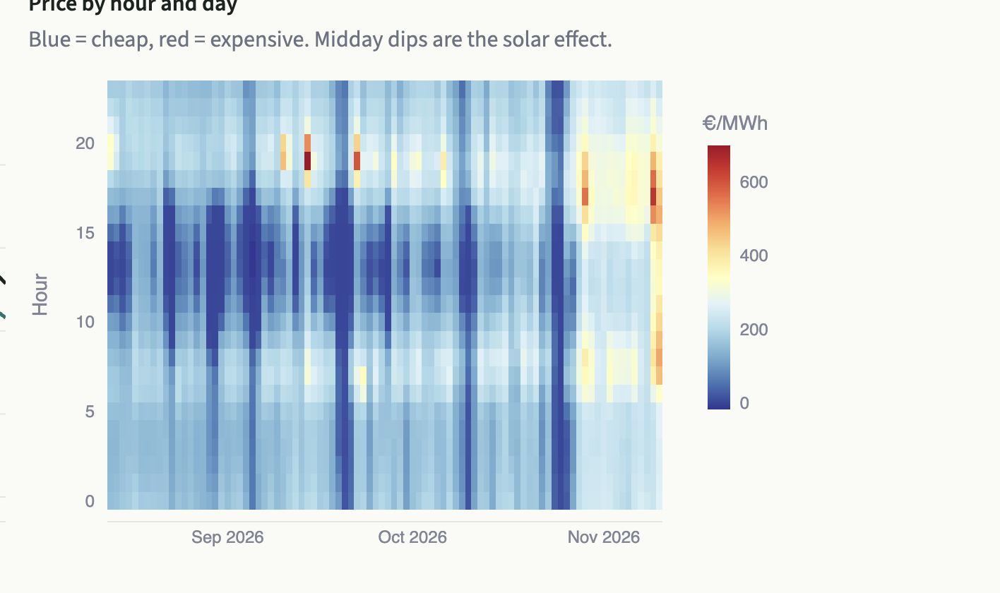

# Energiewende Market Intelligence

Germany gets more and more of its electricity from wind and solar, and that changes how
power prices behave: cheap (sometimes negative) prices at sunny middays, expensive evenings,
and solar farms earning less than the average price. This project collects the public market
data every day, checks it, stores it, and turns it into analysis and a price forecast.

**Live dashboard:** https://energiewende-market-intelligence-dbhpkisxqxwrymfdue6wtg.streamlit.app/

## What it does

1. **Downloads** hourly prices, electricity demand and generation by source (15 series) from
   [SMARD](https://www.smard.de), the Federal Network Agency's open data platform.
   Only new hours are downloaded on each run.
2. **Checks the data.** Impossible values (for example a price above the €4,000 auction limit)
   are moved to a separate table with the reason. It also checks for missing hours,
   duplicates and stale data.
3. **Stores** everything in a SQLite database. Running the pipeline twice never creates
   duplicate rows.
4. **Analyses** the market:
   - how much the price rises per extra GW of demand left after wind and solar (merit order)
   - what solar and wind power actually earn compared with the average price (capture rate)
   - when and why negative prices happen
   - how much a battery could earn by buying cheap and selling expensive
5. **Forecasts** tomorrow's 24 hourly prices with gradient boosting, using only information
   available before the noon auction, and tests it week by week against simply copying
   yesterday's price.
6. **Writes a weekly summary** from the numbers (rule-based, so nothing is made up).
7. **Shows it all** in a Streamlit dashboard.

A GitHub Action runs the pipeline every morning and uploads the database as a GitHub
Release, and the dashboard downloads it from there. No database server and no costs.

## Key findings (as of 10 Nov 2026)

For the latest numbers, see the [live dashboard](https://energiewende-market-intelligence-dbhpkisxqxwrymfdue6wtg.streamlit.app/).

Data from 1 Jan 2024 to 10 Nov 2026, 25,079 hourly prices.

| Finding | Value |
|---|---|
| Average day-ahead price | €94.50/MWh |
| Renewable share of generation | 59.3% |
| Hours with negative prices | 1,492, most often at 13:00 |
| Price increase per extra GW of residual load (last 12 months) | €2.93/MWh (R² 0.53) |
| Average solar capture rate | 0.68 |
| Average wind capture rate | 0.87 |
| 1 MW / 2 MWh battery, last 12 months (best case) | €85,498 |
| Forecast error vs 'same as yesterday' (last 8 weeks) | 3% higher (€46.2 vs €45.0/MWh) |

**What stands out**
- Renewables produced almost 60% of the electricity, but solar earned only about 68% of the
  average price, because all panels produce at the same time and push the price down.
- Prices went below zero in 1,492 hours, most often at 13:00, right at the solar peak.
- Each extra GW of demand left for coal and gas added about €2.90/MWh to the price.
- A small battery could have earned up to about €85,000 per MW in a year (best case).
- My price forecast doesn't beat simply copying yesterday's prices yet (€46.2 vs €45.0/MWh
  average error), though it makes fewer very large mistakes (RMSE €61 vs €63). Predicting
  the change from yesterday instead of the price itself cut the error from €48.0 to €46.2.
  Even a model that sees the actual wind and solar output is only 23% better, so adding
  weather forecasts is the next step.

## Dashboard




The dashboard has eight tabs: overview, merit order, solar & wind value, negative prices,
battery value, forecast, data quality and the weekly brief.

## Tech stack

Python (pandas, NumPy, scikit-learn) · SQL / SQLite · Streamlit · Plotly · pytest · GitHub Actions

## Run it yourself

```bash
python3 -m venv .venv
source .venv/bin/activate
pip install -r requirements.txt

python -m emi.pipeline --demo     # offline demo data, about 30 seconds
python -m emi.pipeline            # real data from SMARD, about 10-15 minutes the first time
python -m streamlit run app.py
python -m pytest
```

## Project structure

```
emi/
  config.py      the 15 SMARD series and their allowed ranges
  smard.py       downloads data from the SMARD API (with retries)
  demo_data.py   fake data for running offline and for tests
  quality.py     data quality checks
  db.py          SQLite reading and writing
  holidays.py    German public holidays
  analysis.py    merit order, capture rates, negative prices, battery value
  forecast.py    price forecast and the week-by-week test
  brief.py       weekly text summary
  report.py      prints the key findings table
  pipeline.py    runs everything in order
sql/schema.sql   tables and the hourly view
app.py           Streamlit dashboard
tests/           20 tests, no internet needed
.github/workflows/  tests on every push, data refresh every morning
```

## Limitations

- The forecast doesn't use weather forecasts yet, which is the biggest driver of prices.
  The "oracle" model in the dashboard shows how much they would help.
- Hourly data only, although the market moved to 15-minute products in October 2025.
- The battery value is a best case (prices known in advance, no fees, no battery wear).
- Fuel and CO₂ prices are not included, and they also move the price.

## Data

Bundesnetzagentur | SMARD.de, licensed under CC BY 4.0.

## Author

**Venkata Praveen Jasthi**, B.Sc. student
[LinkedIn](https://www.linkedin.com/in/venkata-praveen-jasthi-825070357/) · [GitHub](https://github.com/venkatajasthi8-blip)
