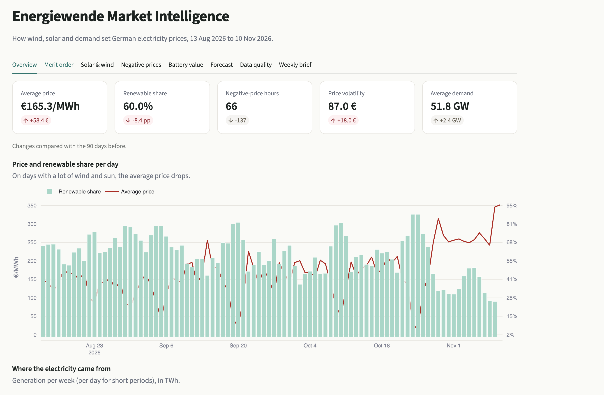
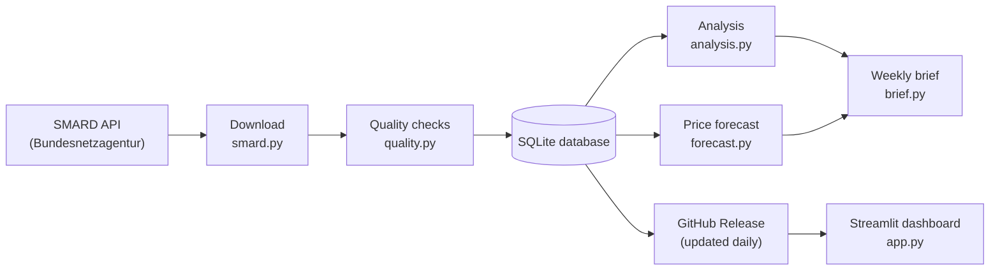
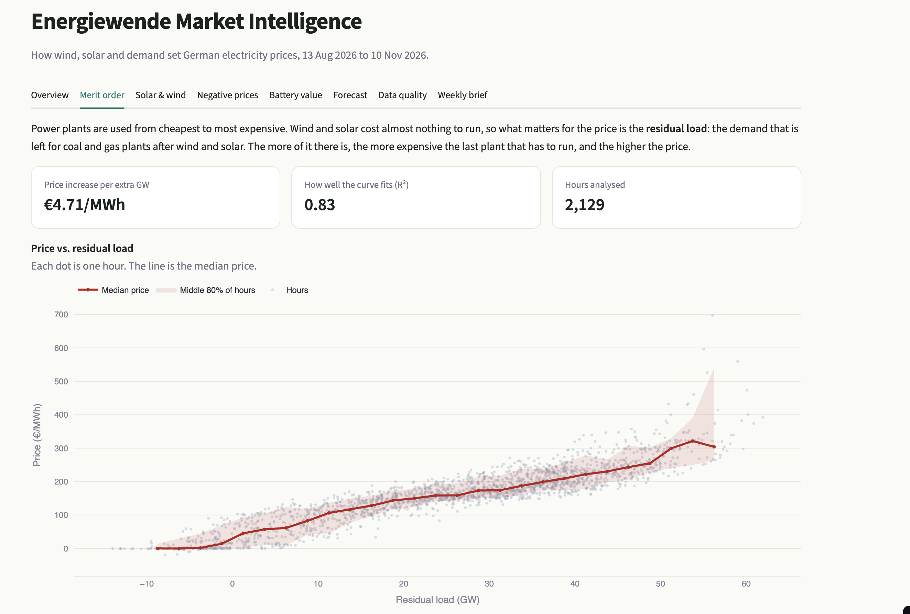

# Energiewende Market Intelligence

[](https://energiewende-market-intelligence-dbhpkisxqxwrymfdue6wtg.streamlit.app/)
[](https://github.com/venkatajasthi8-blip/energiewende-market-intelligence/actions/workflows/tests.yml)


**An automated data pipeline and dashboard that explains how wind, solar and demand drive
German electricity prices, updated every day with official market data.**



Germany gets more and more of its electricity from wind and solar, and that changes how power
prices behave: cheap (sometimes negative) prices at sunny middays, expensive evenings, and solar
farms earning less than the average price. This project collects the public market data every
day, checks its quality, stores it, and turns it into analysis and a price forecast.

**[Open the live dashboard →](https://energiewende-market-intelligence-dbhpkisxqxwrymfdue6wtg.streamlit.app/)**

---

## Contents

- [Why I built this](#why-i-built-this)
- [Key findings](#key-findings-as-of-10-nov-2026)
- [How it works](#how-it-works)
- [Methodology](#methodology)
- [Dashboard](#dashboard)
- [Tech stack](#tech-stack)
- [Getting started](#getting-started)
- [Project structure](#project-structure)
- [Testing and automation](#testing-and-automation)
- [Limitations and next steps](#limitations-and-next-steps)
- [Data and license](#data-and-license)
- [Author](#author)

---

## Why I built this

I study in Germany and kept reading about negative electricity prices and the Energiewende.
I wanted to understand what actually drives the price, and to practise building a complete
data pipeline on live public data instead of a ready-made dataset.

## Key findings (as of 10 Nov 2026)

Based on 25,079 hourly prices from 1 Jan 2024 to 10 Nov 2026. For the latest numbers, see the
[live dashboard](https://energiewende-market-intelligence-dbhpkisxqxwrymfdue6wtg.streamlit.app/).

| Finding | Value |
|---|---|
| Average day-ahead price | €94.50/MWh |
| Renewable share of generation | 59.3% |
| Hours with negative prices | 1,492, most often at 13:00 |
| Price increase per extra GW of residual load (last 12 months) | €2.93/MWh (R² 0.53) |
| Average solar capture rate | 0.68 |
| Average wind capture rate | 0.87 |
| 1 MW / 2 MWh battery, last 12 months (best case) | €85,498 |
| Forecast error vs. "same as yesterday" (last 8 weeks) | 3% higher (€46.2 vs. €45.0/MWh) |

**What stands out**

- Renewables produced almost 60% of the electricity, but solar earned only about 68% of the
  average price, because all panels produce at the same time and push the price down.
- Prices went below zero in 1,492 hours, most often at 13:00, right at the solar peak.
- Each extra GW of demand left for coal and gas added about €2.90/MWh to the price.
- A small battery could have earned up to about €85,000 per MW in a year (best case).
- The price forecast doesn't beat simply copying yesterday's prices yet (€46.2 vs. €45.0/MWh
  average error), though it makes fewer very large mistakes (RMSE €61 vs. €63). Predicting the
  change from yesterday instead of the price itself cut the error from €48.0 to €46.2. Even a
  model that sees the actual wind and solar output is only 23% better, so adding weather
  forecasts is the next step.

## How it works



1. **Download.** Hourly prices, demand and generation by source (15 series) come from
   [SMARD](https://www.smard.de), the Federal Network Agency's open data platform. Only new
   hours are downloaded, plus the last 3 days, because SMARD sometimes corrects recent values.
   Failed requests are retried with increasing wait times.
2. **Quality checks.** Impossible values (for example a price above the €4,000 auction limit)
   are moved to a separate table with the reason instead of being deleted. Every run also
   checks for missing hours, duplicates and stale data.
3. **Storage.** Everything goes into a SQLite database with one row per series per hour.
   Thanks to upserts, running the pipeline twice never creates duplicate rows.
4. **Analysis and forecast.** See [Methodology](#methodology).
5. **Automation.** A GitHub Action runs the pipeline every morning and publishes the database
   as a GitHub Release. The dashboard downloads it from there, so there's no database server
   and no hosting cost.

## Methodology

| Analysis | How it is calculated |
|---|---|
| **Merit order** | A quadratic curve of price against residual load (demand minus wind and solar). The reported number is the slope of that curve at a typical load level. |
| **Capture rate** | Per month: Σ(price × generation) ÷ Σ(generation), divided by the average price. Below 1 means the source mostly produces when power is cheap. |
| **Negative prices** | Counted by hour of day and month, and compared with the renewable share in those hours. |
| **Battery value** | Per day, a 1 MW battery charges in the cheapest hours and sells in the most expensive ones (88% efficiency). This is an upper limit: no fees, no battery wear. |
| **Price forecast** | Gradient boosting (scikit-learn) predicts the change from yesterday's price for each hour of tomorrow. It only uses information available before the 12:00 auction: prices from 24h, 48h and one week earlier, wind/solar/demand from 48h earlier, and the calendar including German public holidays. |
| **Forecast test** | Walk-forward over the last 8 weeks: each week is predicted by a model trained only on earlier data, and compared with "same as yesterday" and "same as last week". An "oracle" model that sees the actual weather shows the upper limit. |

## Dashboard




The dashboard has eight tabs: overview, merit order, solar & wind value, negative prices,
battery value, forecast, data quality and the weekly brief. The period can be switched between
the last 30 days, 90 days, 12 months, all data or a custom range.

## Tech stack

| Area | Tools |
|---|---|
| Language | Python 3.9+ |
| Data | pandas, NumPy |
| Database | SQLite (SQL schema, views, upserts) |
| Machine learning | scikit-learn (HistGradientBoostingRegressor) |
| Dashboard | Streamlit, Plotly |
| Testing | pytest (20 tests, no internet needed) |
| Automation | GitHub Actions, GitHub Releases, Streamlit Community Cloud |

## Getting started

Requires Python 3.9 or newer.

```bash
git clone https://github.com/venkatajasthi8-blip/energiewende-market-intelligence.git
cd energiewende-market-intelligence
python3 -m venv .venv
source .venv/bin/activate        # Windows: .venv\Scripts\activate
pip install -r requirements.txt
```

```bash
python -m emi.pipeline --demo     # offline demo data, about 30 seconds
python -m emi.pipeline            # real data from SMARD, about 10-15 minutes the first time
python -m emi.report              # print the key findings table
python -m streamlit run app.py    # open the dashboard at http://localhost:8501
```

## Project structure

```
emi/
  config.py       the 15 SMARD series and their allowed value ranges
  smard.py        downloads data from the SMARD API, with retries
  demo_data.py    realistic fake data for offline use and tests
  quality.py      data quality checks
  db.py           SQLite reading and writing
  holidays.py     German public holidays
  analysis.py     merit order, capture rates, negative prices, battery value
  forecast.py     price forecast and walk-forward test
  brief.py        rule-based weekly summary
  report.py       key findings table
  pipeline.py     runs every step in order
sql/schema.sql    tables and the hourly view
app.py            Streamlit dashboard
tests/            20 automated tests
.github/workflows/
  tests.yml       runs the tests on every push
  refresh.yml     updates the data every morning
```

## Testing and automation

```bash
python -m pytest
```

The tests run without internet access: the SMARD download is tested against a fake server, and
everything else against generated data. They cover data quality rules, the analysis maths,
duplicate-free loading, a full pipeline run, and a check that the forecast never uses
information from the future.

| Workflow | When | What it does |
|---|---|---|
| `tests.yml` | every push | installs the project and runs all tests |
| `refresh.yml` | daily at 06:17 UTC | downloads new data, reruns analysis and forecast, publishes the database |

## Limitations and next steps

- **No weather forecasts yet.** Weather is the biggest driver of prices. Adding wind and solar
  forecasts is the next step for the price model.
- **Hourly data only,** although the day-ahead market moved to 15-minute products in October 2025.
- **Battery value is a best case:** prices known in advance, no fees, no battery wear.
- **No fuel or CO₂ prices,** which also move the price level.

## Data and license

Market data: Bundesnetzagentur | SMARD.de, licensed under
[CC BY 4.0](https://creativecommons.org/licenses/by/4.0/).
Code: MIT License, see [LICENSE](LICENSE).

## Author

**Venkata Praveen Jasthi**, B.Sc. student
[LinkedIn](https://www.linkedin.com/in/venkata-praveen-jasthi-825070357/) · [GitHub](https://github.com/venkatajasthi8-blip)
